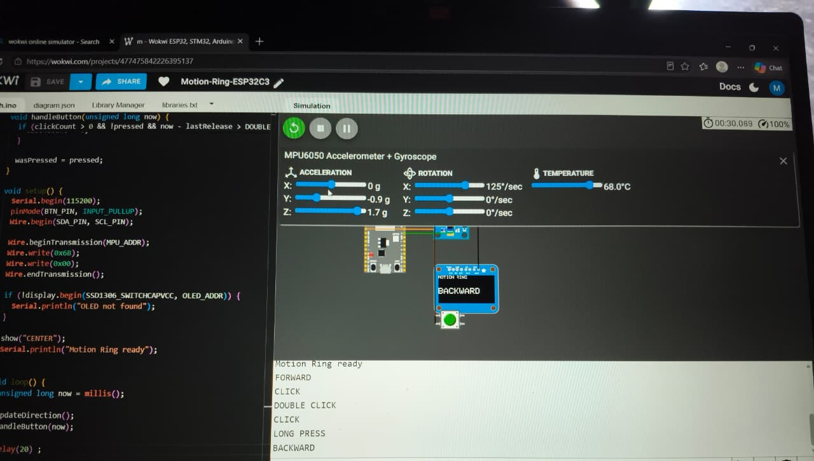

# Motion Ring (ESP32-C3 + MPU6050)

Gesture detection simulated in Wokwi.

## Features
- Left, right, forward, backward and center detection
- Click, double click and long press
- OLED and Serial Monitor output

## Components
- ESP32-C3 DevKit
- MPU6050 (I2C: SDA GPIO8, SCL GPIO9)
- SSD1306 OLED (I2C, same pins)
- Pushbutton (GPIO3 to GND)

## Run
Open the Wokwi project: https://wokwi.com/projects/477475842226395137

